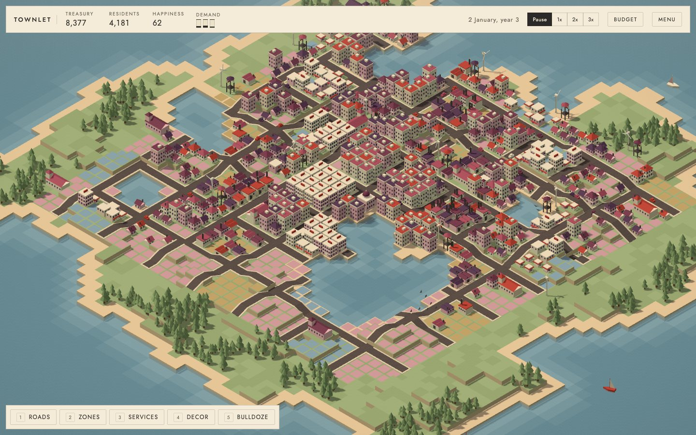
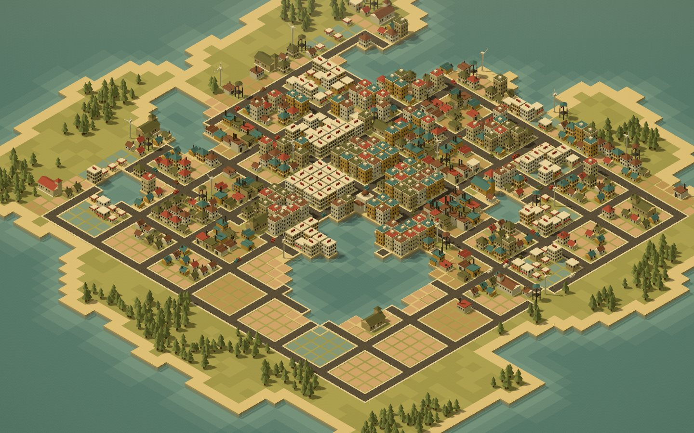
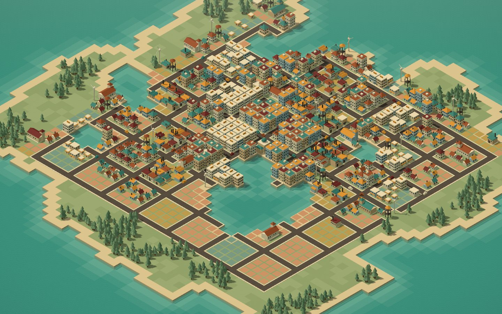
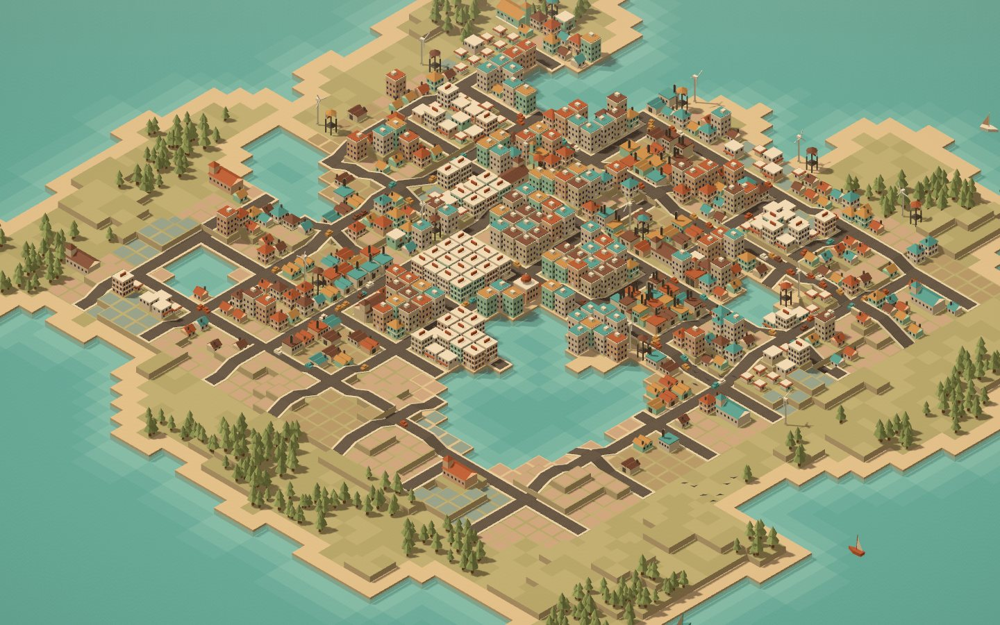
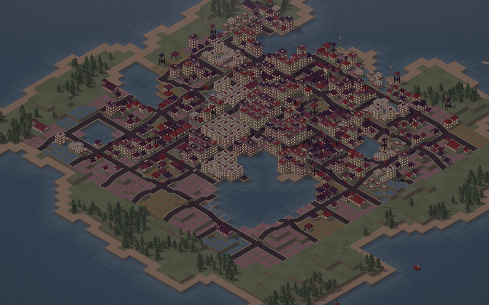

# Townlet

A small city builder in the colours of a Wes Anderson film. Found a town on a
procedurally generated island, lay roads, zone homes, shops and industry, and
keep the residents happy enough to stay. Three difficulties, four palettes, a
day and night cycle, fires, commuters, and a postcard button.



## Playing

```bash
npm install
npm run dev
```

Open the address Vite prints, pick a difficulty and a palette, and found the
town. The first thing to place is the town hall: it provides every service in
a small radius, so build outward from it.

- Roads are the skeleton. Lots grow only within two tiles of a road.
- Zones paint lots residential, commercial or industrial. Homes need jobs,
  shops need customers nearby, factories want other factories and smoke the
  homes next door.
- Lots develop when they have power, water and road access, and when the
  demand bars say people want to move in. Schools, clinics, police and fire
  stations raise a lot's appeal, which decides how far it levels up.
- Everything costs upkeep each month. Taxes come from developed lots. Run out
  of money on normal or hard and the town is lost; easy cannot be lost.
- The land rises in terraces. Roads ramp up a level at a time, lots sit on
  whatever terrace they are zoned on, and the two-by-two services need level
  ground.
- Fires start on their own on normal and hard, spread to neighbours, and burn
  faster under fire station cover. Bulldozing puts a fire out.
- The town is won at 2,000 residents on easy, 5,000 on normal and 10,000 on
  hard. The game keeps going after that.

The game autosaves every month and after every change; the start screen
offers Continue when a save exists.

### Controls

| Input                              | Action                                                           |
| ---------------------------------- | ---------------------------------------------------------------- |
| Left drag                          | Lay a road, zone a rectangle, or bulldoze, with the tool in hand |
| Left click, no tool                | Inspect a tile or building                                       |
| WASD or arrow keys, edge of screen | Pan                                                              |
| Q and E, or right drag             | Rotate the view a quarter turn                                   |
| Wheel                              | Zoom                                                             |
| Middle drag                        | Pan                                                              |
| 1 to 5                             | Roads, Zones, Services, Decor, Bulldoze                          |
| Space                              | Pause and resume                                                 |
| Escape                             | Put the tool down, or open the menu                              |
| M                                  | Sound on or off                                                  |

The menu holds the palette swatches, the postcard button, which saves a PNG of
the town from its best angle, the sound toggle, and a way to start a new town.
All the sound is synthesised in the browser: a sea wash under a soft pad, and
small plucks and chimes for what happens in town.

### Palettes

| Budapest                       | Moonrise                           | Darjeeling                           | Asteroid                           |
| ------------------------------ | ---------------------------------- | ------------------------------------ | ---------------------------------- |
|  |  |  |  |

Night falls every 120 days and tints the town toward the palette's night
colour while the windows light up.



## Development

Vite, TypeScript and Three.js, with no framework. The simulation in `src/sim`
is a plain deterministic module with typed-array grids and no knowledge of the
renderer or the DOM; ESLint enforces that boundary. The renderer in
`src/render` is a set of layers that rebuild from revision counters the sim
bumps when something changes. The HUD in `src/ui` is built once from DOM and
derived per frame.

```bash
npm run check     # lint, typecheck, unit tests
npm run e2e       # Playwright smoke tests against the dev server
npm run shots     # retakes the README screenshots from an autoplayed town
npm run mapdump   # prints a generated map as text for a seed
```

The unit tests include a headless autoplayer that founds and grows a town on
each difficulty and asserts it wins within a bounded number of months. The
design notes and build order live in `tasks/spec.md`.

## Licence

MIT.
